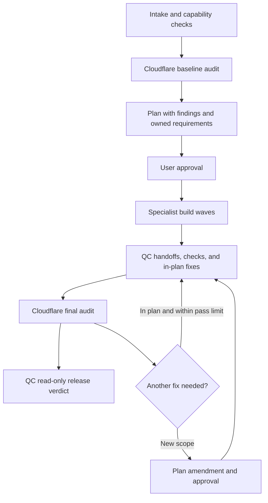

# SecureMe

**Production hardening and launch readiness for web apps, with integrated Cloudflare security audits.**

SecureMe is a Claude Code skill that inspects your application, creates an approval-based implementation plan, coordinates seven specialist builders, and checks the result before issuing a release verdict. It combines security, API resilience, performance, recovery, SEO, accessibility, and content/forms/compliance work.

Cloudflare's bundled security-audit skill runs before planning an existing app and after all implementation changes. Its findings feed the plan, and independent verification checks fixes before the final quality gate.

## Install

```bash
git clone https://github.com/almanalaysay93-gif/secureme ~/.claude/skills/secureme
```

The Cloudflare audit skill is included at a pinned revision. No separate audit-skill installation or runtime download is required.

To update an existing installation with a clean working tree:

```bash
git -C ~/.claude/skills/secureme pull --ff-only
```

## Use

Open Claude Code in the application you want to work on, then describe the task:

```text
/secureme make this Next.js + Supabase app production ready
```

```text
/secureme harden this Express app for launch; keep the existing stack
```

```text
/secureme build a bakery landing page with a menu and contact form
```

SecureMe inspects the actual project and adapts applicable requirements to its stack. It writes `.secureme/PLAN.md` for your approval before changing application code. Existing apps receive a baseline audit first; greenfield projects defer that baseline because there is no application source yet. The final audit remains required.

## How orchestration works



The lead coordinates nine SecureMe roles plus independent Cloudflare audit assignments. Roles run within the host's concurrency limits; they do not require nine simultaneous agents.

| Role | Responsibility |
|---|---|
| Planner-Orchestrator | Inspect the project, map findings to requirements, assign files and build waves |
| Security Builder | Secrets, auth boundaries, headers, uploads, rate limits, and payment idempotency |
| API & Resilience Builder | Timeouts, retries, external-service boundaries, spending controls, and duplicate submissions |
| Data & Performance Builder | Query shape, indexes, pagination, asset delivery, and performance |
| Observability & Recovery Builder | Error tracking, error states, backup/restore guidance, and operational runbooks |
| Technical SEO Builder | Metadata, canonicals, sitemap, robots, structured data, and crawlability |
| UX & Accessibility Builder | Keyboard access, focus, contrast, responsive behavior, and interaction quality |
| Content, Forms & Compliance Builder | Form validation, search, contact access, legal-page scaffolding, and consent UI |
| Quality Gate Agent | Verify requirements against code/runtime evidence, resolve handoffs, and calculate the release verdict |
| Independent Cloudflare audit | Discover and independently validate vulnerabilities, track coverage, and produce structured evidence |

Builders change only files and requirements assigned in the approved plan. Cross-owner changes use explicit handoffs. QC has at most two mutation passes; unresolved work is reported rather than silently expanding scope.

## Integrated Cloudflare audit

SecureMe bundles Cloudflare's MIT-licensed [security-audit skill](https://github.com/cloudflare/security-audit-skill). Each full audit follows six phases:

1. Reconnaissance and trust-boundary mapping.
2. Coverage-led vulnerability hunting.
3. Candidate validation by fresh verifiers.
4. Structured findings and schema validation.
5. Independent verification of final records.
6. Reports derived from verified findings and coverage.

Confirmed findings become owned remediation requirements. Findings that need validation retain their exact unresolved facts and receive no severity. Rejected candidates remain traceable without automatically creating fix tasks.

Auditors inspect application source without modifying it. Builders implement approved fixes; fresh audit verifiers establish closure. The final audit runs after QC finishes source changes. Any subsequent source/configuration change makes that audit stale and requires another final run.

See the [integration contract](references/cloudflare-audit.md) for scheduling, budgets, sandbox rules, finding mappings, and release decisions. [Upstream provenance](vendor/cloudflare-security-audit/UPSTREAM.md) records the bundled revision, license, and update procedure.

## Release verdicts

| Verdict | Meaning |
|---|---|
| `SHIP` | All applicable QC requirements pass, with complete current-source audit evidence, independently closed confirmed findings, and no unresolved audit gaps |
| `SHIP-WITH-MANUAL-ITEMS` | No release-blocking failures remain, but manual work, unresolved validation, or disclosed partial/deferred coverage still needs attention |
| `NOT-READY` | A confirmed vulnerability remains unresolved, the build is broken, a security requirement fails, or final audit evidence is missing, blocked, incomplete, invalid, or stale |

A passing build or builder report alone cannot close a security finding. A clean audit is evidence for the reviewed scope and source revision; it does not guarantee that the application has no vulnerabilities.

## Requirements and execution boundaries

- Claude Code with tool use and sub-agent support. Cloudflare's audit also supports equivalent agent platforms, but SecureMe's documented installation targets Claude Code.
- Node.js for the bundled zero-dependency findings and coverage validators.
- The target application's toolchain for its applicable build and quality checks.
- An OS-enforced sandbox for audit reproductions: no external network, an empty environment populated from a safe allowlist, read-only target/toolchain, per-agent writable scratch, and resource limits.

When audit execution controls are unavailable, inspection remains static and blocked checks stay visible as validation gaps. Missing mandatory audit capabilities are recorded rather than treated as a completed audit. Two full audits and independent verification increase agent usage and execution time; explicit scope and invocation budgets are tracked by the lead.

During a SecureMe run, agents do not commit, push, deploy, rewrite history, or write real secrets. Dashboard/account work such as credential rotation, billing caps, monitoring activation, and backup configuration is handed back as manual work. Audit validation uses bounded local evidence and dummy data rather than probing production services. Legal-page scaffolding still needs review for the application's actual obligations.

## Reports and project files

SecureMe keeps orchestration artifacts in the target application's `.secureme/` directory:

```text
.secureme/
  PLAN.md
  AUDIT.md
  reports/{security,api,data,observability,seo,ux,content}.md
  handoffs/{security,api,data,observability,seo,ux,content}.md
  QC_REPORT.md
```

`AUDIT.md` links stable finding fingerprints to plan rows, owners, evidence, validation blockers, and independent closure checks. Raw Cloudflare outputs default to separate external directories under `~/security-audit-skill/<repo-name>/run-<N>`, including:

- `run-metadata.json`, `architecture.md`, and `coverage-ledger.json`
- `findings.json`
- `REPORT.md`, `FINDINGS-DETAIL.md`, and `NEEDS-VALIDATION.md`

An internal audit output path requires explicit selection and verification that version control ignores the whole directory. Generated artifacts must stay out of application bundles. The final workflow also appends a dated verdict and open-items entry to `PROJECT_MEMORY.md`.

## Repository guide

| Path | Purpose |
|---|---|
| [SKILL.md](SKILL.md) | Entry point, orchestration phases, approval gate, and agent prompts |
| [agents/](agents/) | Planner, specialist builder, and QC instructions |
| [Launch checklist](references/launch-checklist.md) | Canonical launch requirements |
| [Security rulebook](references/security.md) | Security implementation guidance |
| [UX laws](references/ux-laws.md) | UX and accessibility guidance |
| [Cloudflare adapter](references/cloudflare-audit.md) | Audit-to-plan and audit-to-release contract |
| [Bundled audit skill](vendor/cloudflare-security-audit/SKILL.md) | Upstream audit workflow and companion guides |
| [Evaluations](evals/evals.json) | Behavioral scenarios for planning, remediation, and release gates |

## Validation and current limits

Run the bundled upstream validator suites:

```bash
node --test vendor/cloudflare-security-audit/validate-findings.test.cjs vendor/cloudflare-security-audit/validate-coverage-ledger.test.cjs
```

The integration was checked with all 65 validator tests passing, upstream bundle/license parity, local Markdown link checks, evaluation JSON parsing, and whitespace checks. The 14 behavioral evaluation scenarios describe expected agent behavior; they are not an executable end-to-end test harness. A full combined SecureMe orchestration run against a sample application has not yet been performed.

## Attribution

The bundled Cloudflare security-audit skill retains its [MIT license and copyright notice](vendor/cloudflare-security-audit/LICENSE). SecureMe is an independent integration and is not an official Cloudflare product.
